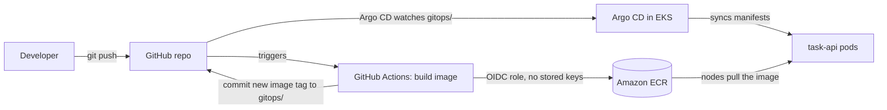
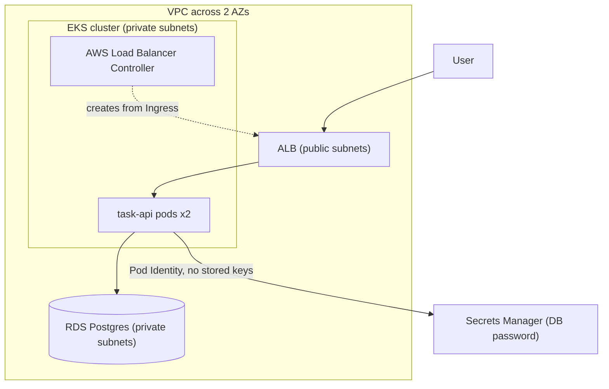
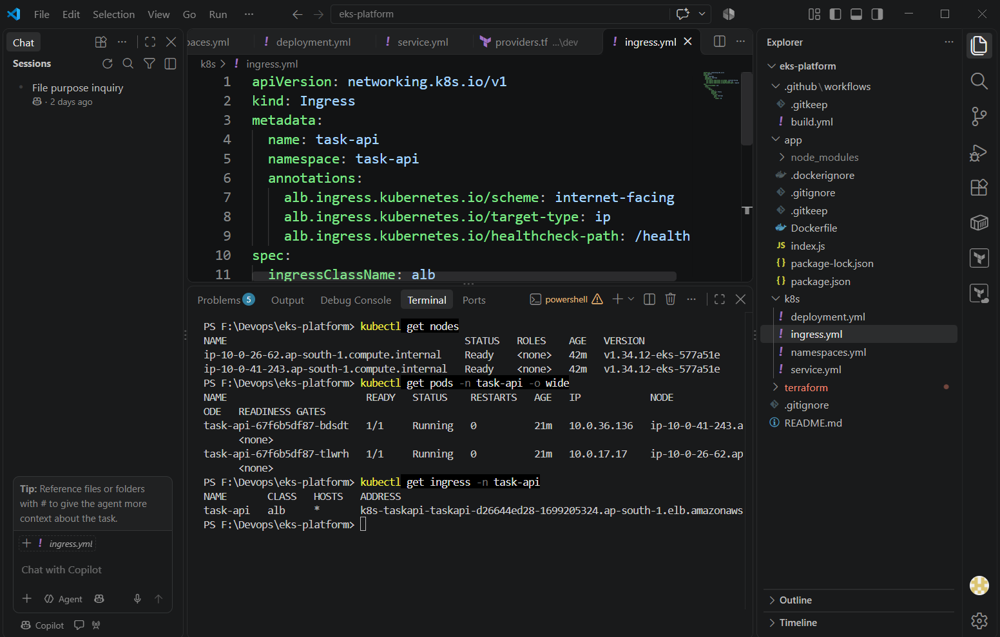
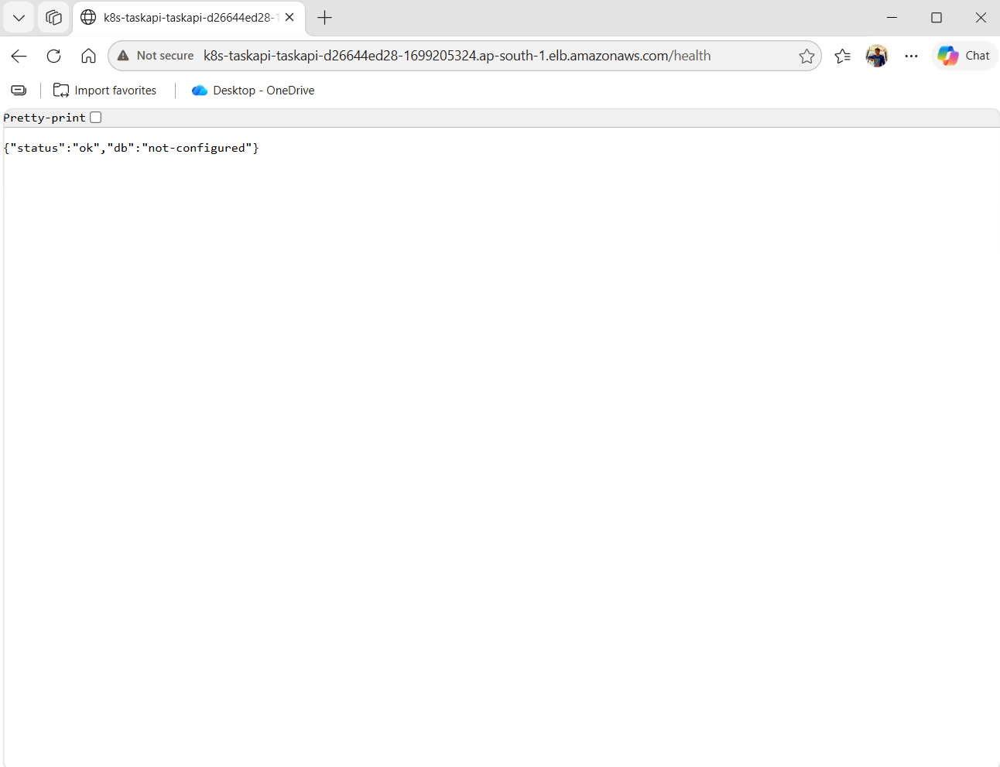
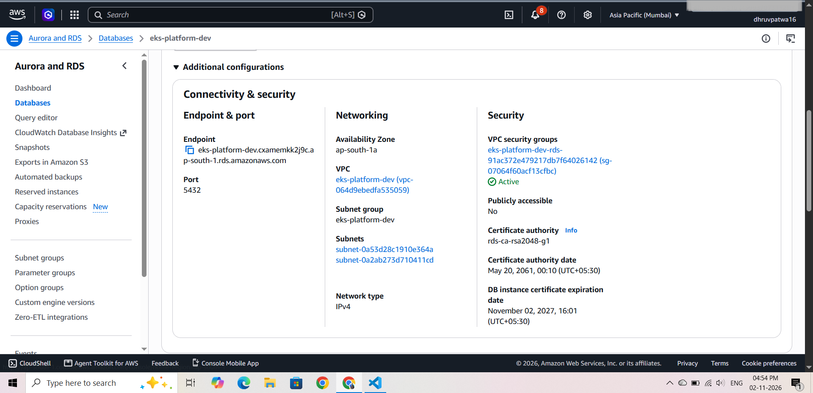
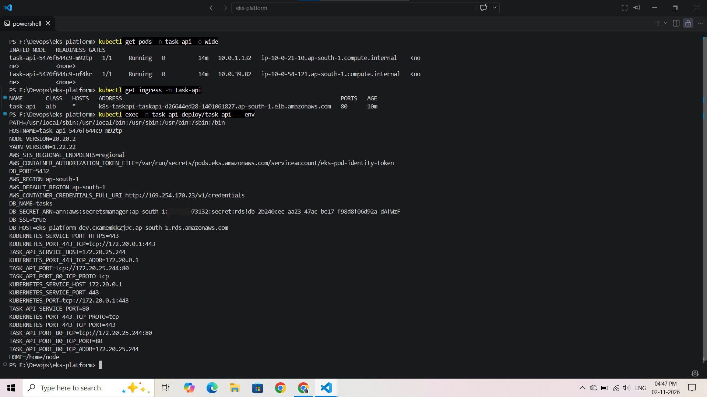
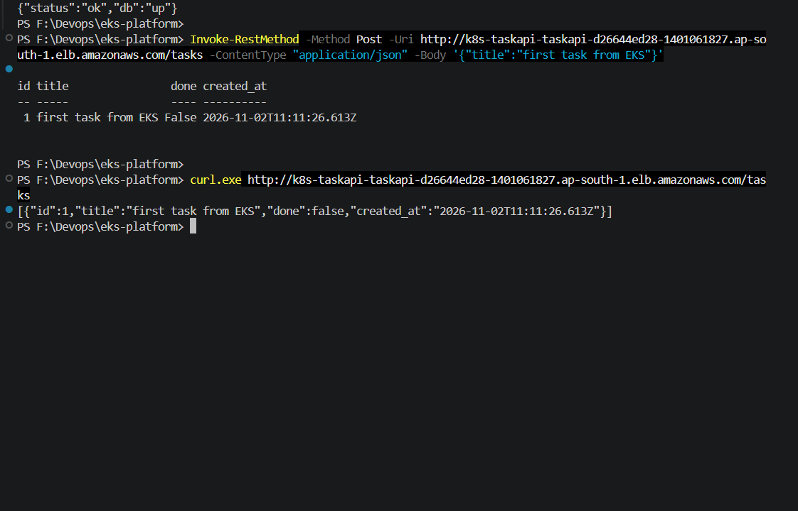
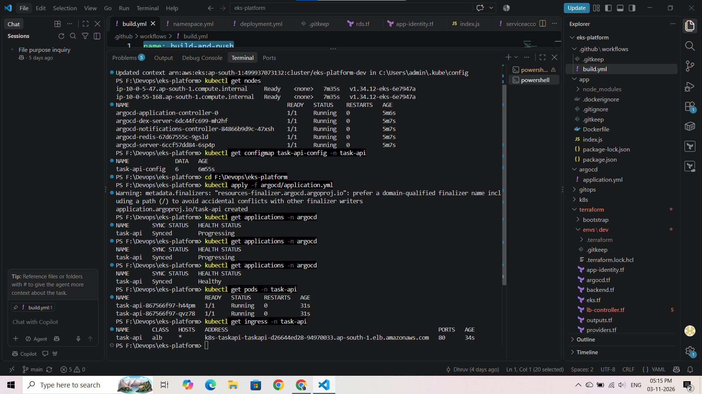
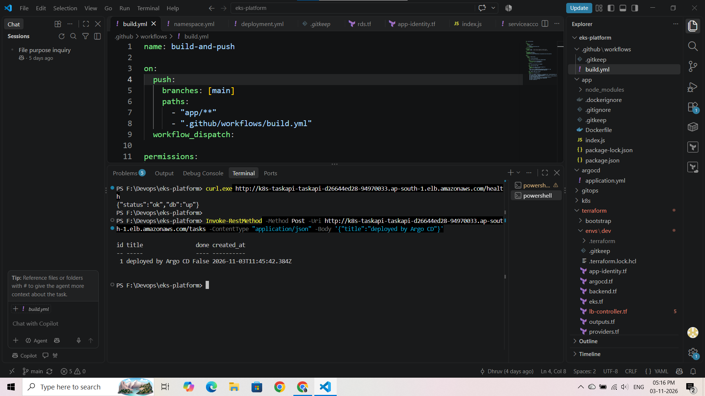
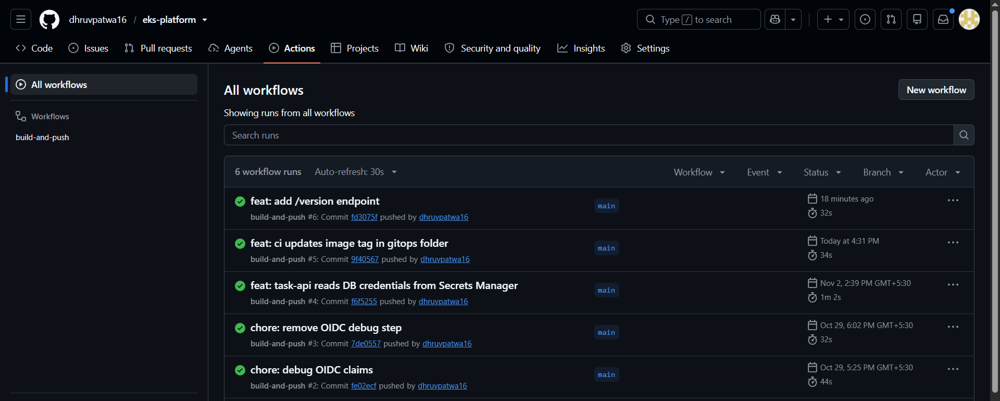

# EKS Platform: GitOps deployment of a Task API on AWS

A production-style platform on **Amazon EKS**, built end to end with Terraform. A `git push` builds the image, updates git, and **Argo CD** rolls the new version out to the cluster. No manual `kubectl`, and no AWS keys stored anywhere.

## What it demonstrates

- **Infrastructure as code:** VPC, EKS, RDS, IAM and the Argo CD install, all in Terraform with remote state in S3.
- **GitOps delivery:** GitHub Actions only builds the image and commits the new tag. Argo CD syncs the cluster from git (auto-sync, prune and self-heal).
- **Keyless CI:** GitHub Actions authenticates to AWS with OIDC, limited to this repo's `main` branch and to pushing images to one ECR repository.
- **No static credentials in pods:** the app reads its database password from AWS Secrets Manager using EKS Pod Identity, with a role scoped to that one secret.
- **Private data layer:** RDS Postgres in private subnets, reachable only from the EKS nodes' security group.
- **Public entry through an ALB:** created by the AWS Load Balancer Controller from a Kubernetes Ingress.

## Architecture

### Delivery flow



### Runtime



## Tech stack

| Area | Tools |
|---|---|
| Cloud | AWS (EKS, VPC, RDS, ECR, ALB, IAM, Secrets Manager) |
| IaC | Terraform (community VPC and EKS modules, Helm and Kubernetes providers) |
| Delivery | GitHub Actions (OIDC), Argo CD |
| App | Node.js and Express, PostgreSQL, Docker |

## Repository layout

```
terraform/
  bootstrap/   S3 bucket for remote state (applied once, never destroyed)
  shared/      ECR repository and the GitHub OIDC role (long-lived)
  envs/dev/    VPC, EKS, RDS, Pod Identity roles, Argo CD, namespace and ConfigMap
app/           Task API and Dockerfile
gitops/        Manifests that Argo CD syncs (deployment, service, service account, ingress)
argocd/        Argo CD Application (applied once per cluster)
.github/       Build workflow
docs/          Architecture and screenshots
```

## The app

A small REST API (`/tasks` create, list, update and delete, plus `/health`). `/health` always returns 200 and reports the database state (`"db":"up"` or `"down"`), so a database problem doesn't restart the pods in a loop. The app is only a workload for the platform.

## How it was verified

| | |
|---|---|
|  |  |
|  |  |
|  |  |
|  |  |

## Running it

Prerequisites: AWS CLI with a profile, Terraform 1.10 or newer, kubectl. The state bucket name in the backend files is account-specific, so use your own.

1. `terraform/bootstrap`: `terraform apply` (once) to create the state bucket.
2. `terraform/shared`: `terraform apply` (once) for ECR and the GitHub OIDC role.
3. Push a change under `app/` so CI builds the first image and commits its tag into `gitops/`.
4. `terraform/envs/dev`: `terraform apply` (about 25 to 30 minutes) for the VPC, EKS, RDS and Argo CD.
5. `aws eks update-kubeconfig --name eks-platform-dev --region ap-south-1`, then `kubectl apply -f argocd/application.yml`.
6. Argo CD syncs `gitops/`, and the Ingress creates the ALB. Read the address with `kubectl get ingress -n task-api` and call `/health`.

**Tear down (order matters):** `kubectl delete -f argocd/application.yml` (this removes the Ingress and therefore the ALB, which Terraform doesn't know about), wait until `aws elbv2 describe-load-balancers` is empty, then `terraform destroy` in `terraform/envs/dev`. Skipping this leaves the ALB behind and the VPC deletion gets stuck.

## Design decisions and trade-offs

These are deliberate, to keep a destroy-after-every-session setup cheap:

- **Single NAT gateway:** cheaper, but a single point of failure.
- **RDS single-AZ, no backups, no final snapshot, no deletion protection:** fine for a demo that is rebuilt often, and a real setup would turn all of these on.
- **Public cluster endpoint** (open to `0.0.0.0/0`): convenient for learning. It would be restricted or private in production.
- **HTTP only:** no domain, so no HTTPS yet.
- **Admin permissions on the Terraform IAM user:** acceptable for a personal sandbox, and it would be scoped down on a team.
- **Cost:** roughly $0.35 to $0.45 per hour while the full stack runs, so it is applied for a session and destroyed afterwards.

## Not built yet (planned as follow-up updates)

HTTPS with a custom domain, autoscaling (HPA and Karpenter) with a load test, observability (Prometheus and Grafana), image scanning and NetworkPolicies, and a zero-downtime EKS upgrade runbook.

## Problems hit along the way

See [docs/problems-and-fixes.md](docs/problems-and-fixes.md).